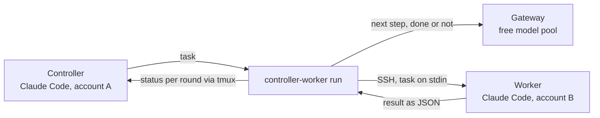

# controller-worker

[](https://github.com/ulliiiiiiiii/controller-worker/actions/workflows/ci.yml)

Delegation between two Claude Code instances on two machines, each on its own account. The
controller hands out tasks and the worker executes them. The glue in between, choosing the
next step and judging whether a task is done, runs on a free model gateway, so the paid
quotas are only spent on real work.



## How a run works

1. The gateway turns the task and the results so far into one concrete next step.
2. `controller-worker run-task` executes that step on the worker machine with
   `claude --print`, under a hard cost limit, resuming the worker's previous session.
3. The gateway decides from the result whether the task is done.
4. Each round is typed into the controller's tmux session, so the controller follows along
   live, and written to a JSON state file.

A run ends when the task is done or the round limit is reached.

## Safeguards

- Cost limit per worker call via `--max-budget-usd`: 1 USD unless `WORKER_BUDGET_USD` or
  `--budget-usd` sets another amount.
- Round limit per run (`--rounds`, default 3).
- Rate limits, gateway errors (429, 502, 503, 504) and dropped connections are retried with
  a growing pause. Any other error stops the run and is recorded in the state file.
- A verdict only counts if the reply starts with DONE. A substring check would read
  "CONTINUE, not DONE yet" as finished.
- `usage` reads the raw session logs of both accounts instead of trusting what the agents
  report about their own work, and asks the gateway for patterns in them.

## Setup

Install on both machines:

```sh
pipx install git+https://github.com/ulliiiiiiiii/controller-worker
```

The worker needs Claude Code and has to accept SSH logins from the controller with a key.
If `controller-worker` is not on the PATH of non-interactive SSH sessions there, pass the
full path with `--worker-command`.

On the controller, point it at any OpenAI-compatible endpoint:

```sh
export GATEWAY_BASE_URL=https://openrouter.ai/api/v1
export GATEWAY_API_KEY=...
export GATEWAY_MODEL=...
```

## Usage

```sh
# controller: at most five rounds, status goes to the tmux session "controller"
controller-worker run "find out why the nightly backup job failed and fix it" \
    --worker worker-host --rounds 5 --notify-tmux controller

# worker side, normally started by `run` over SSH
echo "list failed systemd units" | controller-worker run-task --budget-usd 0.5

# usage patterns of both accounts
controller-worker usage --worker worker-host
```

The state of the last run is kept in `~/.local/state/controller-worker/last-run.json`.

## Development

```sh
python -m venv .venv && . .venv/bin/activate
pip install -e '.[dev]'
pytest
ruff check . && ruff format --check . && mypy
```

The tests use a fake `claude` executable and a stubbed gateway, so they never spend quota.

## License

[MIT](LICENSE)
